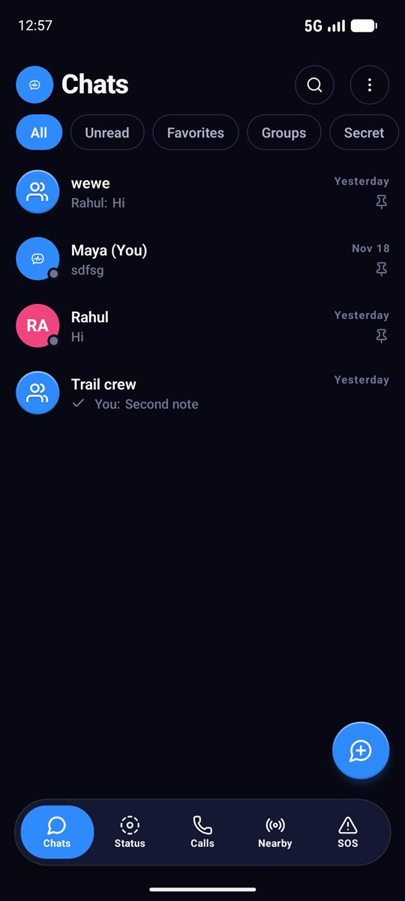
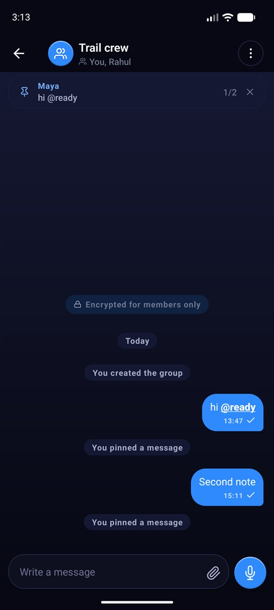
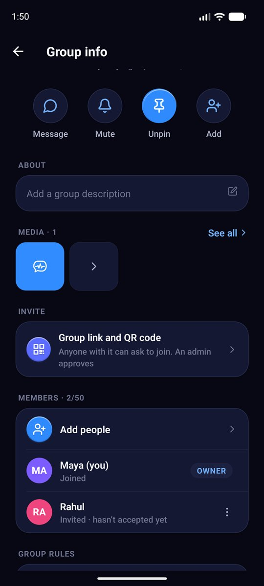
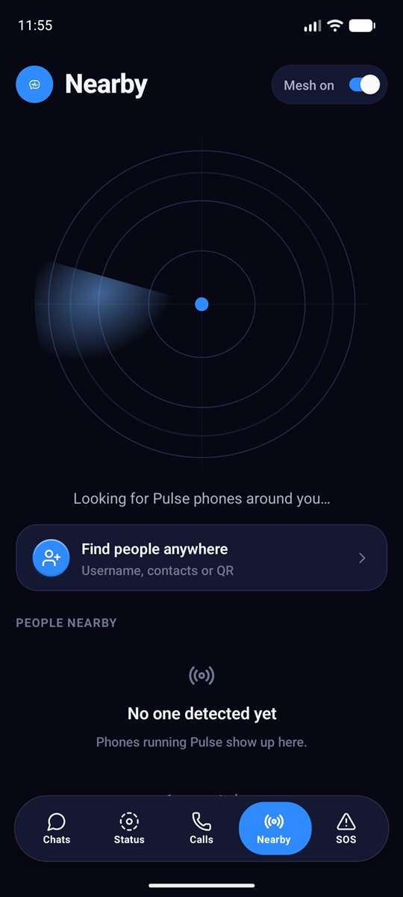
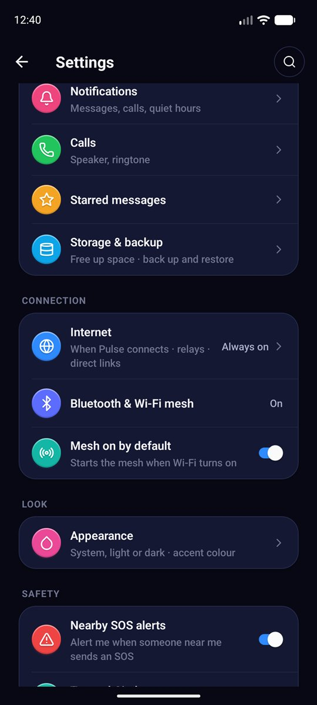
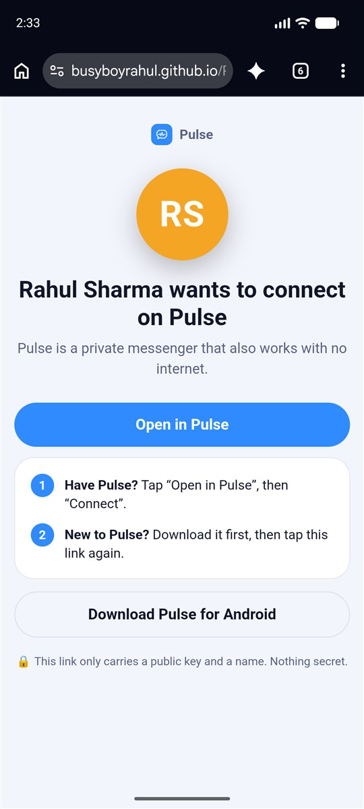

<div align="center">


# Pulse

### Chat, call and send an SOS — even when there is no signal.

Pulse is a private messenger for Android. Nearby phones pass messages to each other,
so your words can reach a friend with **no mobile data, no Wi-Fi and no account**.
When you do have internet, Pulse uses that too.

<br>

<a href="../../releases/latest/download/Pulse.apk">
  
</a>

<sub>Version 1.1 · 57 MB · Android 6.0 or newer · [all releases](../../releases)</sub>

<br>


</div>

---

## 👋 Why Pulse?

<table>
<tr>
<td width="33%" valign="top">

### 📡 Works with no signal
Phones near each other pass your message along, like friends handing a note down a row.
A message can hop through other Pulse phones until it reaches the right person.

</td>
<td width="33%" valign="top">

### 🔒 Private by design
Every chat is end-to-end encrypted. There is **no account** and no phone number is needed.
The phones that carry a message for you **cannot read it**.

</td>
<td width="33%" valign="top">

### 🆘 Help in one hold
Press and hold SOS. Pulse sends your location to every Pulse phone nearby and
gets a text ready for your trusted people.

</td>
</tr>
</table>

---

## 📱 Take a look

<div align="center">
<table>
<tr>
<td align="center"><br><sub><b>Chats</b><br>pinned, groups, secret</sub></td>
<td align="center"><br><sub><b>Pinned messages</b><br>up to 3 per chat</sub></td>
<td align="center"><br><sub><b>Groups</b><br>picture, admins, rules</sub></td>
</tr>
<tr>
<td align="center"><br><sub><b>Nearby</b><br>the mesh switch + radar</sub></td>
<td align="center"><br><sub><b>Settings</b><br>mesh, internet, privacy</sub></td>
<td align="center"><br><sub><b>Share links</b><br>tap in WhatsApp, open Pulse</sub></td>
</tr>
</table>
</div>

---

## ⬇️ Get it in 3 steps

1. **Download** — tap the green button above (or [click here](../../releases/latest/download/Pulse.apk)) on your Android phone.
2. **Open the file** — if Android asks, allow **Install unknown apps** for your browser or Files app.
3. **Start Pulse** — make your local profile and allow the Bluetooth, Nearby and notification questions.

> 💡 To watch Pulse relay a message you need **two phones**, and **three** to see a message hop through the one in the middle.
>
> ⚠️ Android shows an "unknown source" warning because Pulse is not on the Play Store and is signed with a debug key. That is expected.

---

## 🧠 How it works

```
   ┌─────┐   in range   ┌─────┐   in range   ┌─────┐
   │  A  │ ───────────▶ │  B  │ ───────────▶ │  C  │
   └─────┘              └─────┘              └─────┘
   writes a sealed      can't read it,       opens it and
   message to C         just carries it      sends a ✓✓ back
```

Pulse has three roads and uses whichever works:

| Road | When | What it uses |
|---|---|---|
| 📶 **Nearby mesh** | People are close, even through other Pulse phones | Google Nearby Connections (Bluetooth + Wi-Fi) |
| 🌐 **Internet** | You have data or Wi-Fi | Public relay mailboxes + direct encrypted links. No Pulse server. |
| 💬 **SMS (SOS only)** | No data at all | Your own messages app, with the text ready — you tap Send |

If the person is not reachable yet, a phone in between **holds the message** and hands it over when they come into range.

---

## ✨ What you can do

<details open>
<summary><b>💬 Chat</b></summary>

| | |
|---|---|
| **One-to-one, nearby or far** | Send to someone in range, through other phones, or over the internet |
| **Delivery ticks** | Sent ✓ · delivered ✓✓ · read — and a small relay icon if it hopped |
| **Message info** | A page for each message: the steps it went through and, in groups, who read it |
| **Rich messages** | Bold, italic, strike, mono, spoilers, emoji, replies, edit (15 min), forward, star, copy, reactions |
| **Media** | Several photos at once, videos and any file up to 25 MB, voice notes, polls, shared contacts |
| **Pinned messages** | Pin up to **3** messages to the top of a group or one-to-one chat. A new pin never removes the others (not in secret chats or chats with disappearing messages) |
| **Delete** | For you, or for everyone |
| **Disappearing messages** | 24 hours, 7 days or 90 days, plus view-once photos |
| **Secret chats** | Extra-private chats with their own keys and a self-destruct timer |
| **Look** | Wallpapers with opacity and blur, labels, favourites, archive, search, mute, notes to yourself |

</details>

<details>
<summary><b>👥 Groups</b></summary>

| | |
|---|---|
| **Create in two steps** | Pick people, then give it a name, picture and description |
| **Up to 50 people** | Everyone gets their own sealed copy, over the mesh or the internet |
| **Admins** | Add or remove people, make other admins. Removing someone changes the group's key |
| **Rules** | Who may change the name and picture · who may send (turn on "admins only" for an announcement group) |
| **Join by link** | Anyone with the link can ask to join — an **admin must say yes** |
| **Who got it** | Read by · delivered to · not delivered yet · not joined yet, by name |
| **@mentions** | Type `@` to pick someone. A mention still reaches you in a muted group |
| **Everything is recorded** | "Maya added Rahul", "You pinned a message" show right in the chat |
| **Shared media** | A small strip of photos in the group info, and a full Media screen with tabs for photos, files and links |

</details>

<details>
<summary><b>📞 Calls</b></summary>

- **Voice calls over the mesh** — encrypted, they work through nearby phones.
- **Voice and video over the internet** — WebRTC, with free public fallbacks (you can add your own server in Settings → Internet).
- Only people you are connected with can ring you. No phone number is ever shown.
- **Minimise** a call and a green bar at the top keeps it one tap away.
- A call history with one-tap call back. Names always show names, never IDs.
- Answer or decline right from the notification.

_Group calls are not available yet._

</details>

<details>
<summary><b>🔎 Finding people</b></summary>

| | |
|---|---|
| **@usernames** | Unique with no server — the **oldest claim wins**. Check a name before you take it |
| **QR code or link** | Show your code, or share a link. Opening it offers "Connect" |
| **Your contacts** | Optional: find friends who already use Pulse |
| **Phone number** | Optional and off by default. A number is only trusted after a text-message check |
| **Many accounts** | Keep several accounts on one phone |

</details>

<details>
<summary><b>🆘 Safety</b></summary>

- **SOS** — press and hold, with a 5-second cancel window. Your location goes to nearby Pulse phones, and a text with your location is prepared for your **Trusted Circle** (you tap Send).
- **Safety notes** — leave a short note for people near a spot.
- **Responder mode** — see a redacted "someone nearby may need help" alert. Switch it off any time.

</details>

<details>
<summary><b>🔒 Privacy &amp; security</b></summary>

- **End-to-end encryption** (NaCl: X25519 + XSalsa20-Poly1305) for messages, groups and call audio.
- **Relay phones can't read anything** they carry.
- **Two separate locks:** an **app lock** (PIN, fingerprint or face) and a **chat lock** with its own code. Locked chats live in a hidden folder with hidden previews.
- **Number privacy:** your number is optional and masked everywhere.
- **Encrypted backup** to a `.pulsebak` file protected by your passphrase.
- Data on the phone is encrypted using the **Android Keystore**.

</details>

---

## 📶 The mesh switch, in plain words

The Bluetooth &amp; Wi-Fi mesh is **off until you turn it on** (Nearby tab). Your phone's Wi-Fi and Bluetooth belong to you, so Pulse follows these rules:

| | Rule |
|---|---|
| 1️⃣ | **Mesh on** → Pulse starts looking for people and lets Android turn Wi-Fi/Bluetooth on if they were off. The mesh stays on. |
| 2️⃣ | **Mesh off** → Pulse never touches your Wi-Fi or Bluetooth. Opening the app never turns them on. |
| 3️⃣ | **You turn Wi-Fi off** → the mesh switch turns itself off. |
| 4️⃣ | **Wi-Fi is on** → the mesh turns on only if you chose **Settings → Mesh on by default**. It is off unless you choose it. |

Messages over the internet work either way. There is **no permanent background notification** — a short one shows only while you are on a call or while the mesh is starting.

> ℹ️ Android does not let any app switch Wi-Fi on by itself. Pulse asks Android's own Nearby service to do it when you flip the mesh on. On some phones it may not, and then the mesh waits and the Settings row reads "Wi-Fi is off".

---

## 🔗 Links you can tap

Pulse share links are normal web addresses, so WhatsApp, Telegram and SMS make them tappable:

```
https://busyboyrahul.github.io/Pulse/add#k=…&n=Maya        ← connect with a person
https://busyboyrahul.github.io/Pulse/join#g=…&a=…&n=Trail%20crew   ← ask to join a group
```

Tapping one opens a small page with the person or group, an **Open in Pulse** button, and a download button for people who don't have Pulse yet.
Everything after the `#` stays on the phone — it never reaches the web server — and a link only carries a public key and a name, nothing secret. Older `pulse://` links still work.

---

## ❓ Questions

<details>
<summary><b>Does Pulse need the internet?</b></summary>
No. Nearby phones work with none. Internet is used when you have it, and you can switch it off or limit it to "only when Pulse is open" in Settings → Internet.
</details>

<details>
<summary><b>Do I need an account or a phone number?</b></summary>
No. Pulse makes a key pair on your phone the first time you open it. A phone number is optional.
</details>

<details>
<summary><b>Why does Pulse not run in the background all the time?</b></summary>
A permanent "running in the background" notification is annoying, so Pulse no longer shows one. While Pulse is running, messages arrive; if Android pauses Pulse, waiting messages arrive when you open it.
</details>

<details>
<summary><b>Is there an iPhone version?</b></summary>
Not yet. It needs a Mac and Apple's tools to build.
</details>

<details>
<summary><b>Why does Android warn me before installing?</b></summary>
Pulse is installed from this page, not from the Play Store, and it is signed with a debug key. Android warns about any app installed this way.
</details>

---

## 🧪 How sure are we?

| | |
|---|---|
| ✅ **Checked** | **256 automated tests pass**, including three virtual phones relaying A → B → C, groups over the internet, files, backup and locks. The release app was tried on an Android emulator. |
| ⚠️ **Not yet proven** | Real-radio range, call audio quality, relaying with the screen off, and whether Nearby turns Wi-Fi on for every phone need a **field test with real phones**. The checklist is in [docs/AUDIT_AND_FIXES.md](docs/AUDIT_AND_FIXES.md). |
| 🚧 **Limits** | Android only. Large files are slow over the mesh. Pairing is trust-on-first-use. Backups don't include photos, files or voice notes. |
| 🗺️ **Not built** | iPhone version · group voice and video calls |

---

## 🛠️ For developers

<details>
<summary><b>Build it yourself</b></summary>

**Needs:** Node 18+, JDK 17 and the Android SDK. Details: [docs/NATIVE_SETUP.md](docs/NATIVE_SETUP.md).

```powershell
npm install
npm run typecheck
npm test                 # 256 tests
npm run android          # run on a connected phone or emulator
```

**Build the installable APK** (Windows, one command):

```powershell
.\build-apk.ps1          # produces Pulse.apk on your Desktop
```

**Publish a release** (the download button always serves the newest one):

```powershell
gh release create v1.2 Pulse.apk --latest --title "Pulse 1.2"
gh release delete v1.1 --cleanup-tag -y      # keep only the newest
```

</details>

<details>
<summary><b>Tech stack</b></summary>

| Layer | What |
|---|---|
| App | React Native 0.75 · TypeScript · Zustand · React Navigation · Reanimated |
| Crypto | TweetNaCl (box, secretbox, sign) |
| Internet | Public relays for sealed mailboxes · WebRTC links and calls · no Pulse server for chat |
| Native (Kotlin) | Nearby mesh · call audio · notifications · secure store · media files · contacts · QR scanner · app share |
| Tests | Jest, with a virtual-phone harness (A, B, C with their own keys and storage) |
| Link page | Plain HTML, CSS and JavaScript in [`site/`](site), published with GitHub Pages |

</details>

<details>
<summary><b>Repository layout</b></summary>

```
Pulse/
├── App.tsx                 # root: navigation + gates (onboarding, lock)
├── src/
│   ├── screens/            # Chats, Conversation, Group info, Nearby, Calls, Settings…
│   ├── components/         # UI kit (Screen, Avatar, Popover, MediaStrip, CallBar…)
│   ├── mesh/               # mesh engine, relay protocol, Nearby transport, mesh rules
│   ├── net/                # internet: relays, WebRTC links, internet calls, @usernames
│   ├── store/              # Zustand stores (chat, groups, calls, pairing, prefs, locks…)
│   ├── services/           # crypto, ratchet, notifier, backup, links, names, media…
│   ├── sos/                # SOS packet + relay bridge
│   ├── testing/            # virtual-phone harness used by the tests
│   └── theme/              # design tokens
├── android/                # native project + Kotlin modules (com.pulse)
├── site/                   # the page that opens when a shared link is tapped (GitHub Pages)
├── server/                 # optional phone-check backend (not needed to chat)
└── docs/                   # testing, native setup, privacy policy, store notes, audit log, screenshots
```

</details>

---

## 📚 More

[Testing](docs/TESTING.md) · [Native setup](docs/NATIVE_SETUP.md) · [Privacy policy](docs/PRIVACY_POLICY.md) · [Store submission](docs/STORE_SUBMISSION.md) · [Audit &amp; fixes](docs/AUDIT_AND_FIXES.md) · [What changed](CHANGELOG.md)

<div align="center"><sub>Built for the moments when there's no signal. · © 2026 Creoteck</sub></div>
